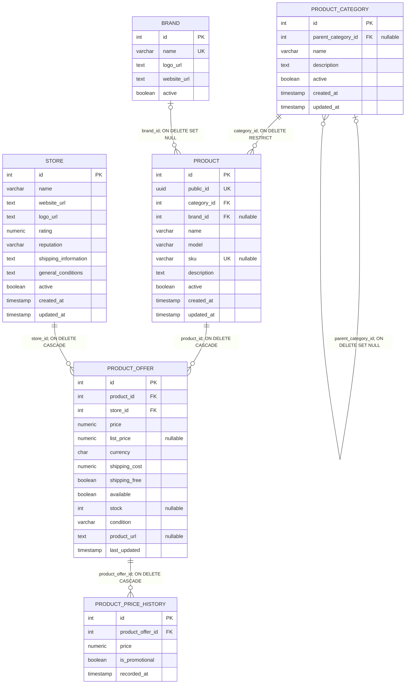

# Modelo relacional del catálogo de productos

## Fuente y alcance

Este diagrama representa el DDL observado después de aplicar, en orden, las
migraciones
[001_schema.sql](../../backend/database/migrations/001_schema.sql) a
[007_store_and_category_name_unique.sql](../../backend/database/migrations/007_store_and_category_name_unique.sql)
en una base PostgreSQL 16.15 desechable y vacía, el 23-10-2026. La fuente de
verificación fue `pg_dump --schema-only --no-owner --no-privileges -U postgres
-d tal_audit` ejecutado dentro del contenedor temporal
`solo_tal59_tmp_20261023`, además de consultas de solo lectura a `pg_constraint`
y `pg_indexes`. El dump terminó con `exit=0`.

Se muestran las cinco tablas solicitadas y `brand`, porque `product.brand_id`
es otra FK real del producto y dibujarla evita dejar una referencia externa sin
destino. Los tipos se simplifican a los tipos SQL usuales de PostgreSQL.

## ER del esquema final



`||` indica exactamente uno; `o{` indica cero o muchos; `o|` indica cero o
uno. En consecuencia, cada producto pertenece obligatoriamente a una categoría,
mientras una categoría puede tener cero o muchos productos. Una categoría raíz
puede no tener padre; cada oferta requiere exactamente un producto y una tienda;
y cada oferta puede tener cero o muchos puntos de historial.

## Identidad de las ofertas tras la migración 006

La definición inicial de
[001_schema.sql](../../backend/database/migrations/001_schema.sql#L118-L135)
declaraba `UNIQUE (product_id, store_id)`. La migración
[006_offer_identity_and_url_index.sql](../../backend/database/migrations/006_offer_identity_and_url_index.sql#L1-L10)
elimina la constraint anterior y crea el índice único:

```sql
CREATE UNIQUE INDEX uq_product_offer_product_store_url
    ON product_offer (product_id, store_id, COALESCE(product_url, ''));
```

La base reconstruida confirmó esa expresión mediante `pg_indexes`. Así, la
identidad vigente es producto + tienda + URL almacenada, haciendo que `NULL`
colisione con cadena vacía para la misma pareja producto/tienda. **No** hay
normalización adicional de la URL: no aplica `BTRIM`, `LOWER`, ni elimina
parámetros de tracking. Además, la unicidad permite el mismo URL para productos
distintos en una tienda, o el mismo URL en tiendas distintas.

La migración 007 añade, además, unicidad normalizada para `store.name` mediante
`LOWER(BTRIM(name))`, y para categorías mediante
`(COALESCE(parent_category_id, 0), LOWER(BTRIM(name)))`.

La FK del historial se define como
`product_offer_id REFERENCES product_offer(id) ON DELETE CASCADE`. El diagrama
representa esta cardinalidad pero también implica que borrar físicamente una
oferta borra su historial; el borrado de producto o tienda llega al mismo
resultado por las FKs en cascada de la oferta.

## Comparación con `MER normalizado.pdf`

El PDF se pudo leer en un entorno virtual temporal con `pypdf` (`PdfReader`,
página 1). El texto extraído muestra `PRODUCT`, `PRODUCT_CATEGORY`, `STORE`,
`PRODUCT_OFFER` y `PRODUCT_PRICE_HISTORY`; sus campos identifican `category_id`,
`product_id`, `store_id` y `product_offer_id` como FKs, y aparecen relaciones
`1:N`. Esto coincide con las relaciones principales del diagrama actual.

El PDF también lista `derived_average_rating` y `derived_review_count` en
`PRODUCT`, marcados “remove from storage”. No existen como columnas en la base
actual; [002_views.sql](../../backend/database/migrations/002_views.sql)
calcula ambos valores en `product_rating_summary`, en
concordancia con esa marca del MER. El PDF no documenta el índice único por URL
introducido por `006`; esa regla es posterior y está únicamente en la
migración.

Archivo revisado: [MER normalizado.pdf](./MER%20normalizado.pdf), página 1. La
comparación describe el texto extraíble; no evalúa la calidad visual ni los
conectores gráficos que no aparecen en la extracción de texto.
